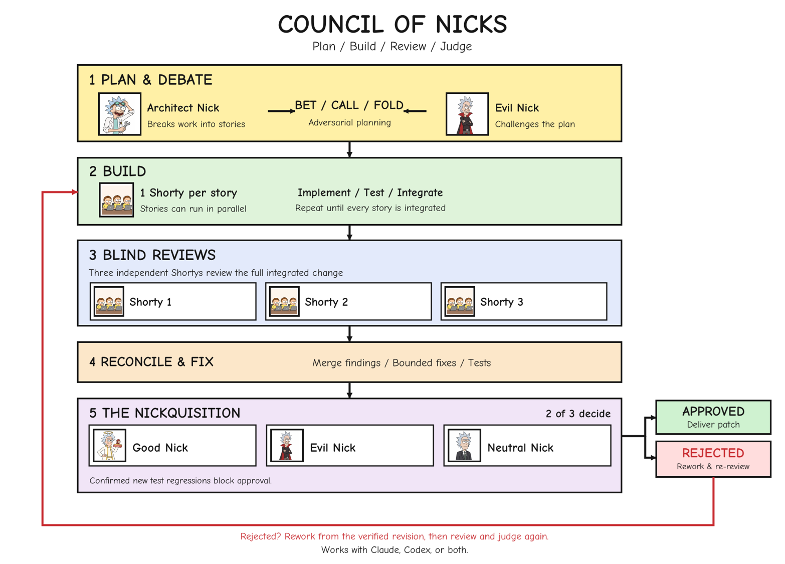

# Council of Nicks

*Many Nicks. One codebase. No single Nick gets the final word.*

Council of Nicks builds and reviews software with independent AI agents, automated verification, and a three-judge verdict.

Run every workflow—guided, unattended delivery, rework, and competing implementations—from Claude Code or Codex CLI. Choose your Claude subscription, your ChatGPT/Codex subscription, or both independently of the host.

## Meet the Nicks

| Nick | Job description |
|---|---|
|  | **Architect Nick** — A mad genius who turns your wild ideas into plans the Shortys can actually build. Manic laughter included. |
|  | **Good Nick** — A fair-minded mentor who wants you to succeed. Spots what works, explains what doesn’t, and keeps the fire extinguisher within reach. |
|  | **Evil Nick** — Hates everything, especially you and your changes. Fights every line of code and keeps your failing tests in a trophy cabinet. |
|  | **Neutral Nick** — A gray suit with a spreadsheet for a soul. Hears everyone out, then votes for whichever option makes the most profit. |
|  | **The Shortys** — Less genius, zero prestige, all the grunt work. They carry out the Nicks’ grand plans. Quantity has a quality of its own. |

## How it works



1. **Plan.** Architect Nick splits a feature into bounded, testable stories. Evil Nick challenges the plan in a BET / CALL / FOLD debate.
2. **Build.** A worker implements each task in an isolated worktree. Scope checks and tests gate integration.
3. **Review.** Three independent blind reviews inspect the integrated change by default. Findings are reconciled and fixes verified.
4. **Judge.** Good Nick, Evil Nick, and Neutral Nick investigate, deliberate, and vote. All three valid ballots are required; two out of three decide. Confirmed new test regressions can still block approval.
5. **Rework.** With user authorization, repairs start from the exact rejected revision. Delta Nickquisition checks unresolved blockers and regressions introduced by the correction, without reopening unrelated unchanged code.

The Python orchestrator manages execution, evidence, verification, and vote counting. No single agent can approve a change. Independent sessions may use the same model.

## Two ways to build

- **Default:** One implementation per task, independent blind reviews, reconciliation, and final judgment.
- **Competition:** Two independent implementations of one selected story, a third comparison, implementer challenges, and one verified selection before judgment.

## Install and configure

Requires Python 3.10+, Git, Linux bubblewrap, and the CLI(s) logged in to the subscriptions you use.

```sh
./install.sh
```

The installer provides skills for Claude Code and Codex CLI, backed by the same `nicks` CLI and engine.

Choose **one** subscription configuration:

```sh
nicks config set subscriptions claude-only  # Claude subscription
nicks config set subscriptions codex-only   # ChatGPT/Codex subscription
nicks config set subscriptions both         # Both subscriptions
```

You can also use `auto` to detect available subscription logins. For subscription-only operation, set Restricted mode **before initialization**:

```sh
nicks config set mode restricted
nicks init
nicks doctor
nicks config show
```

The default Hybrid mode also permits free/local routes. Use `nicks config set mode hybrid` to enable it.

## Use it

In Claude Code, start with `/nicks dev "Describe the feature"`. In Codex CLI, use the installed `nicks` skill. The underlying CLI is the same:

```sh
nicks review master
nicks dev deliver --repo . --request "Describe the feature" --max-seconds 3600
```

Delivery launches one headless host session as Architect Nick: Claude Code (Opus or Sonnet) or Codex CLI. If only one subscription is authorized, that one hosts. With both, `NICKS_HOST=claude` or `NICKS_HOST=codex` chooses, and Codex is the default. The Claude Code skill sets `NICKS_HOST=claude`. A Claude host gets only file and shell tools inside the same jail and drives the same `nicks` commands.

Delivery returns an `engine_state` path and plan/job IDs. Use that state to inspect the result or explicitly authorize rework of a concluded rejection:

```sh
NICKS_HOME=/path/from/engine_state nicks dev status PLAN
NICKS_HOME=/path/from/engine_state nicks nickquisition verdict JOB --json
NICKS_HOME=/path/from/engine_state nicks dev rework PLAN --from REJECTED_JOB --max-seconds 3600
```

Each rework returns its own state and IDs. Use those for inspection and any separately authorized next cycle. A completed workflow can end in REJECT; completion is not approval.

For one ready story in an existing prepared plan, opt into competition:

```sh
nicks dev compete PLAN TASK --max-seconds 1800
```

Competition uses Codex Luna when Codex is authorized and Claude Haiku otherwise. Haiku proposals are tool-less and applied by Python. The comparison and challenges see the packet inline, with earlier turns replayed verbatim.

From inside Claude Code, run `deliver`, `rework`, and `compete` as background commands. They outlast the 10-minute foreground limit.

Resume interrupted Council reviews with `nicks resume JOB` in that job's state. See the [workflow guide](nicks/WORKFLOW.md) for planning, integration, judging, and stage-specific recovery.

## The rules

- **Blind reviews.** Reviewers don't see each other's findings before submitting.
- **Evidence over confidence.** Tests, diffs, raw outputs, dissent, and decisions are preserved.
- **No silent approvals.** Missing or invalid ballots leave judgment incomplete; failed checks stay visible.
- **Small, verifiable stories.** Every change has a bounded scope and acceptance criteria.
